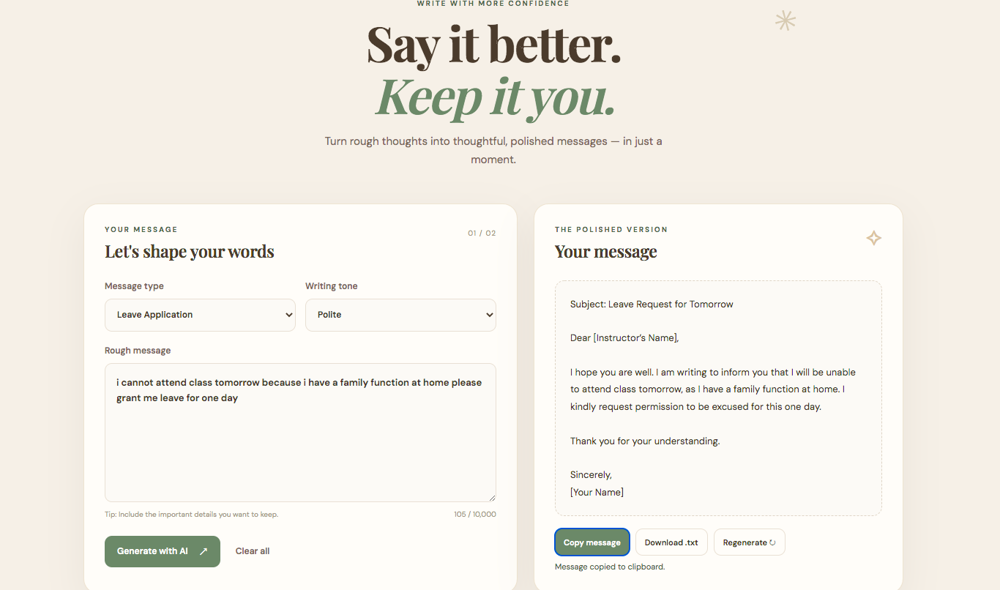
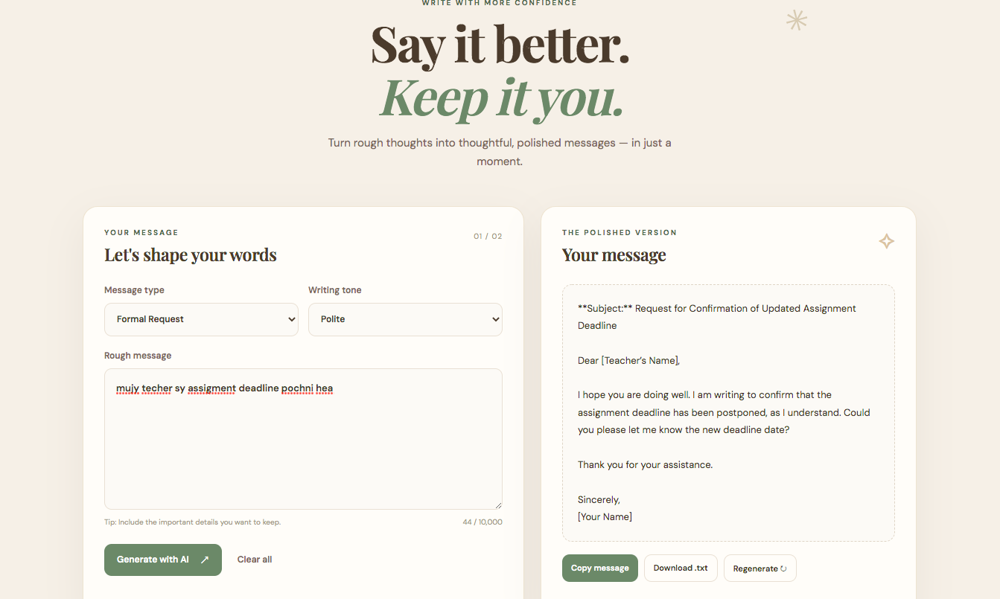

# AI Email & Message Assistant

A beginner-friendly full-stack web app that improves rough text into clear messages using Flask and the Groq API.

## Features

- Four message categories: Professional Email, Student Message, Leave Application, and Formal Request
- Three writing tones: Professional, Polite, and Friendly
- Real AI generation through the Groq API
- Input validation and helpful error messages
- Regenerate, copy, download, and clear controls
- Responsive warm earthy interface (cream, beige, brown, and sage green)

## Requirements

- macOS with Python 3 installed
- A Groq API key from [Groq Console](https://console.groq.com/)
- Internet connection for AI generation

## Setup on macOS

Open Terminal, move into this project folder, and run:

```bash
cd path/to/AI_Email_Message_Assistant
python3 -m venv venv
source venv/bin/activate
python3 -m pip install -r requirements.txt
cp .env.example .env
```

Open the `.env` file in VS Code or a text editor and replace `your_groq_api_key_here` with your own private Groq API key. Do not share this key or upload `.env` to GitHub.

## Run the application

With the virtual environment activated, run:

```bash
python3 app.py
```

Then open this address in your browser:

http://127.0.0.1:5000

To stop the local server, return to Terminal and press `Control + C`.

## Project structure

```text
AI_Email_Message_Assistant/
├── app.py
├── groq_service.py
├── prompts.py
├── requirements.txt
├── .env.example
├── .gitignore
├── README.md
├── templates/
│   └── index.html
└── static/
    ├── style.css
    └── script.js
```

## GitHub safety

The real `.env` file is excluded by `.gitignore`. Upload `.env.example`, not `.env`. Never commit your API key.

## Troubleshooting

- **Groq API key is missing:** Check that `.env` exists in the main project folder and contains `GROQ_API_KEY=...`.
- **Model error:** Set `GROQ_MODEL` in `.env` to a model currently available to your Groq account.
- **Package error:** Activate the environment with `source venv/bin/activate`, then run `python3 -m pip install -r requirements.txt`.
- **Page not opening:** Make sure `python3 app.py` is still running, then visit `http://127.0.0.1:5000`.
## Application Screenshots

### 1. English Message Generation


### 2. Roman Urdu Message Generation

